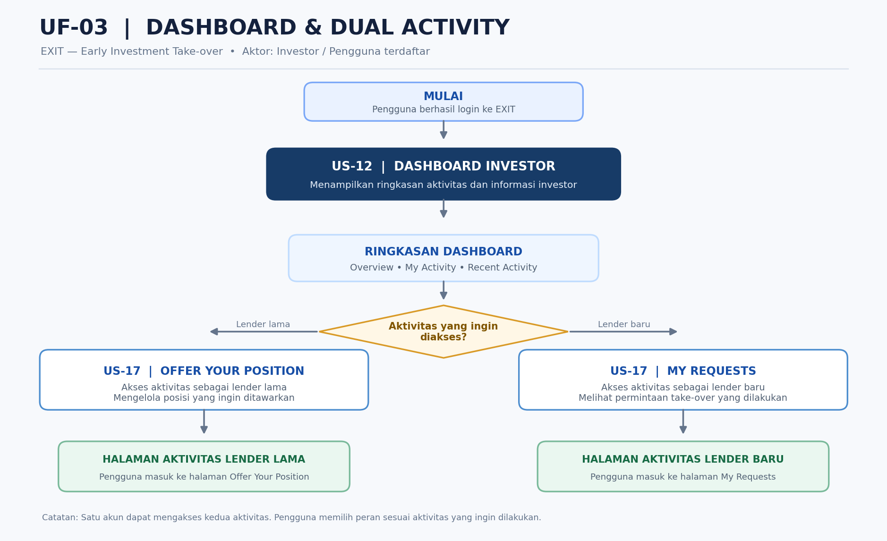

# UF-03: Dashboard & Dual Activity

**Product:** EXIT — Early Investment Take-over  
**Feature:** Dashboard & Dual Activity  
**Actor:** Investor / Pengguna terdaftar  
**Related User Stories:** US-12, US-17  
**Access:** Registered User (setelah login)

## 1. Deskripsi

User Flow ini menjelaskan proses pengguna setelah berhasil login ke platform EXIT. Pengguna akan diarahkan ke Dashboard untuk melihat ringkasan aktivitas investasi, kemudian dapat memilih aktivitas sesuai perannya sebagai lender lama maupun lender baru.

Melalui satu akun, pengguna dapat mengakses dua aktivitas yang berbeda, yaitu Offer Your Position untuk menawarkan posisi investasi dan My Requests untuk melihat aktivitas permintaan take-over.

## 2. Rincian User Stories

### US-12: Dashboard Investor

**User Story:**

Sebagai investor, saya ingin melihat dashboard agar dapat mengetahui ringkasan aktivitas investasi saya.

**Acceptance Criteria:**
- Dashboard menampilkan informasi ringkasan investor.
- Dashboard menyediakan bagian Overview.
- Dashboard menyediakan bagian My Activity.
- Dashboard menyediakan bagian Recent Activity.

**Informasi yang ditampilkan:**
- Overview: ringkasan informasi aktivitas investor.
- My Activity: aktivitas yang dilakukan oleh pengguna.
- Recent Activity: aktivitas terbaru pengguna.

### US-17: Dual Activity dalam Satu Akun

**User Story:**

Sebagai investor, saya ingin dapat mengakses fitur penawaran dan permintaan take-over melalui satu akun agar dapat menjual maupun mengambil alih posisi investasi sesuai kebutuhan.

**Acceptance Criteria:**
- Satu akun pengguna dapat mengakses aktivitas sebagai lender lama dan lender baru.
- Pengguna dapat mengakses halaman Offer Your Position sebagai lender lama.
- Pengguna dapat mengakses halaman My Requests sebagai lender baru.
- Sistem menyediakan navigasi untuk mengakses kedua aktivitas tersebut.

**Pembagian aktivitas pengguna:**

| Peran | Halaman | Fungsi |
|---|---|---|
| Lender Lama | Offer Your Position | Mengakses aktivitas penawaran posisi investasi |
| Lender Baru | My Requests | Mengakses aktivitas permintaan take-over |

## 3. User Flow Diagram

Berikut merupakan diagram alur Dashboard dan Dual Activity pada platform EXIT.

## 4. Output

Hasil dari proses Dashboard & Dual Activity meliputi:
- Dashboard investor yang menampilkan Overview, My Activity, dan Recent Activity.
- Akses aktivitas sebagai lender lama melalui Offer Your Position.
- Akses aktivitas sebagai lender baru melalui My Requests.
- Satu akun pengguna yang dapat mengakses kedua aktivitas sesuai kebutuhan.

## 5. Catatan

- Pengguna harus berhasil login sebelum mengakses Dashboard.
- Satu akun dapat menjalankan aktivitas sebagai lender lama maupun lender baru.
- Offer Your Position dan My Requests merupakan dua halaman aktivitas yang berbeda.
- Detail proses pengajuan penawaran posisi akan dijelaskan lebih lanjut pada UF-05: Offer Position Management.
- Detail proses permintaan take-over akan dijelaskan lebih lanjut pada UF-07: Negotiation & Take-Over Request.
