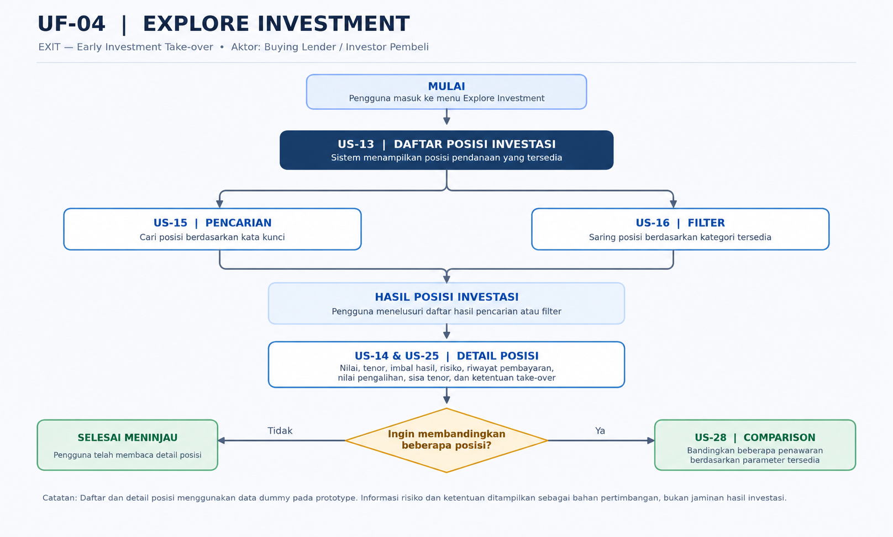

# UF-04: Explore Investment

**Product:** EXIT — Early Investment Take-over  
**Feature:** Explore Investment  
**Actor:** Buying Lender / Investor Pembeli  
**Related User Stories:** US-13, US-14, US-15, US-16, US-25, US-28  
**Access:** Registered User (setelah login)

## 1. Deskripsi

User Flow ini menjelaskan proses investor pembeli dalam mengeksplorasi posisi pendanaan yang tersedia di platform EXIT. Pengguna dapat melihat daftar posisi investasi, mencari berdasarkan kata kunci, menggunakan filter kategori, serta melihat detail informasi dan risiko posisi sebelum mempertimbangkan pengambilalihan.

Selain itu, pengguna dapat membandingkan beberapa penawaran berdasarkan parameter yang tersedia untuk membantu menentukan pilihan sesuai kebutuhan dan pertimbangannya.

## 2. Rincian User Stories

### US-13: Melihat Daftar Posisi Investasi

**User Story:**

Sebagai investor pembeli, saya ingin melihat daftar posisi investasi yang tersedia agar dapat menemukan peluang take-over.

**Acceptance Criteria:**
- Daftar posisi investasi yang tersedia ditampilkan pada halaman Explore Investment.

### US-14: Melihat Detail Posisi Investasi

**User Story:**

Sebagai investor, saya ingin melihat detail posisi investasi agar dapat memahami informasi sebelum melakukan keputusan.

**Acceptance Criteria:**
- Detail nilai posisi tersedia.
- Informasi tenor ditampilkan.
- Informasi imbal hasil ditampilkan.
- Informasi risiko tersedia.

### US-15: Pencarian Posisi Investasi

**User Story:**

Sebagai investor, saya ingin mencari posisi investasi berdasarkan kata kunci agar lebih mudah menemukan peluang.

**Acceptance Criteria:**
- Fitur pencarian dapat digunakan berdasarkan kata kunci.
- Sistem menampilkan hasil pencarian sesuai kata kunci yang dimasukkan.

### US-16: Filter Posisi Investasi

**User Story:**

Sebagai investor, saya ingin memfilter posisi investasi berdasarkan kategori tertentu agar pencarian lebih terarah.

**Acceptance Criteria:**
- Filter dapat digunakan berdasarkan kategori yang tersedia.
- Sistem menampilkan posisi sesuai kategori yang dipilih.

### US-25: Informasi Risiko dan Ketentuan Posisi

**User Story:**

Sebagai investor pembeli, saya ingin melihat informasi risiko dan ketentuan posisi investasi agar dapat mempertimbangkan keputusan take-over.

**Acceptance Criteria:**
- Informasi risiko posisi ditampilkan.
- Riwayat pembayaran tersedia.
- Nilai pengalihan posisi ditampilkan.
- Informasi sisa tenor tersedia.
- Ketentuan take-over ditampilkan.

**Informasi detail yang ditampilkan:**

| Informasi | Keterangan |
|---|---|
| Nilai posisi | Nilai posisi pendanaan |
| Tenor | Jangka waktu pendanaan |
| Imbal hasil | Informasi potensi imbal hasil |
| Risiko | Informasi risiko posisi |
| Riwayat pembayaran | Catatan pembayaran posisi |
| Nilai pengalihan | Nilai yang ditawarkan untuk pengalihan |
| Sisa tenor | Sisa jangka waktu pendanaan |
| Ketentuan take-over | Persyaratan dan ketentuan pengalihan posisi |

### US-28: Perbandingan Penawaran

**User Story:**

Sebagai investor penjual dan pembeli, saya ingin membandingkan beberapa penawaran agar dapat menentukan pilihan yang sesuai dengan kebutuhan.

**Acceptance Criteria:**
- Informasi beberapa penawaran dapat dibandingkan.
- Perbandingan disajikan berdasarkan parameter yang tersedia.
- Sistem menampilkan ringkasan perbandingan penawaran.

## 3. User Flow Diagram

Berikut merupakan diagram alur eksplorasi posisi investasi pada platform EXIT.

## 4. Output

Hasil dari proses Explore Investment meliputi:
- Daftar posisi investasi yang tersedia.
- Fitur pencarian berdasarkan kata kunci.
- Fitur filter berdasarkan kategori.
- Halaman detail posisi investasi.
- Informasi risiko dan ketentuan take-over.
- Fitur perbandingan beberapa penawaran berdasarkan parameter yang tersedia.

## 5. Catatan

- Fitur Explore Investment ditujukan untuk investor pembeli atau Buying Lender.
- Pengguna harus login sebelum mengakses fitur ini.
- Informasi posisi, nilai pengalihan, imbal hasil, dan riwayat pembayaran pada prototype menggunakan data dummy.
- Informasi risiko dan ketentuan ditampilkan sebagai bahan pertimbangan, bukan sebagai jaminan keuntungan atau keberhasilan take-over.
- Perbandingan penawaran menggunakan parameter yang tersedia pada data prototype.
- Pengajuan permintaan take-over dibahas lebih lanjut dalam UF-07: Negotiation & Take-Over Request.
