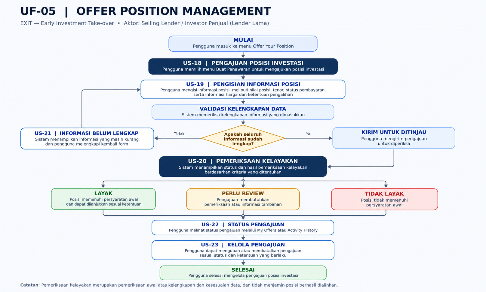

# UF-05: Offer Position Management

**Product:** EXIT — Early Investment Take-over  
**Feature:** Offer Position Management  
**Actor:** Selling Lender / Investor Penjual (Lender Lama)  
**Related User Stories:** US-18, US-19, US-20, US-21, US-22, US-23  
**Access:** Registered User (setelah login)

## 1. Deskripsi

User Flow ini menjelaskan proses investor penjual dalam mengajukan posisi investasi yang ingin dialihkan kepada investor lain melalui platform EXIT.

Pengguna dapat mengisi informasi posisi investasi, mengirim pengajuan untuk diperiksa, mengetahui hasil pemeriksaan kelayakan, memantau status pengajuan, serta mengubah atau membatalkan penawaran sesuai status dan ketentuan yang berlaku.

## 2. Rincian User Stories

### US-18: Pengajuan Posisi Investasi
Pengguna dapat mengakses menu Offer Your Position dan mengajukan posisi investasi yang ingin dialihkan.

### US-19: Pengisian Informasi Posisi
Pengguna mengisi informasi posisi investasi, termasuk nilai posisi, tenor, status pembayaran, serta informasi harga dan ketentuan pengalihan yang relevan.

### US-20: Pemeriksaan Kelayakan Posisi
Pengguna dapat mengetahui hasil pemeriksaan kelayakan posisi berdasarkan kriteria yang ditentukan, yaitu Layak, Perlu Review, atau Tidak Layak.

### US-21: Informasi Kelengkapan Pengajuan
Pengguna memperoleh informasi mengenai data yang belum lengkap atau memerlukan perbaikan sebelum pengajuan dapat dilanjutkan.

### US-22: Pemantauan Status Pengajuan
Pengguna dapat melihat status pengajuan posisi melalui halaman My Offers atau Activity History.

### US-23: Pengelolaan Pengajuan
Pengguna dapat mengubah atau membatalkan pengajuan sesuai status dan ketentuan yang berlaku.

## 3. Alur Proses

1. Pengguna membuka menu Offer Your Position.
2. Pengguna memilih Buat Penawaran.
3. Sistem menampilkan formulir pengajuan posisi investasi.
4. Pengguna mengisi informasi posisi yang diperlukan.
5. Sistem memeriksa kelengkapan informasi.
6. Jika informasi belum lengkap, sistem menampilkan bagian yang harus diperbaiki.
7. Jika informasi lengkap, pengguna mengirim pengajuan untuk ditinjau.
8. Sistem menampilkan status Menunggu Pemeriksaan.
9. Pemeriksaan kelayakan dilakukan berdasarkan kriteria yang ditentukan.
10. Sistem menampilkan hasil pemeriksaan: Layak, Perlu Review, atau Tidak Layak.
11. Pengguna memantau status pengajuan melalui My Offers atau Activity History.
12. Pengguna dapat mengubah atau membatalkan pengajuan sesuai status dan ketentuan yang berlaku.

## 4. Aturan dan Catatan

- Informasi posisi harus lengkap agar dapat diperiksa.
- Hasil pemeriksaan kelayakan tidak menjamin posisi berhasil dialihkan.
- Perubahan dan pembatalan pengajuan mengikuti status serta ketentuan yang berlaku.
- Posisi yang memenuhi persyaratan awal dapat dilanjutkan ke proses berikutnya sesuai ketentuan EXIT.

## 5. Diagram User Flow

