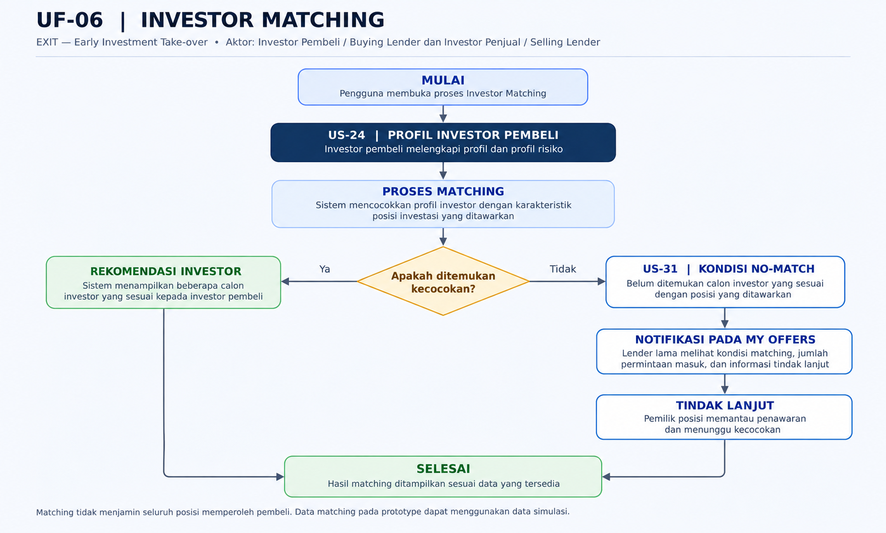

# UF-06: Investor Matching

**Product:** EXIT — Early Investment Take-over  
**Feature:** Investor Matching  
**Actor:** Investor Pembeli / Buying Lender dan Investor Penjual / Selling Lender  
**Related User Stories:** US-24, US-31  
**Access:** Registered User (setelah login)

## 1. Deskripsi

User Flow ini menjelaskan proses pencocokan antara investor pembeli dengan posisi investasi yang ditawarkan oleh investor penjual melalui platform EXIT.

Sistem memberikan rekomendasi calon investor berdasarkan kriteria yang ditentukan dan karakteristik posisi investasi. Profil serta profil risiko investor pembeli menjadi salah satu pertimbangan dalam proses pencocokan.

Selain itu, sistem memberikan informasi kepada investor penjual apabila belum ditemukan kecocokan dengan calon investor. Informasi tersebut ditampilkan melalui halaman My Offers agar investor penjual dapat mengetahui kondisi matching, jumlah permintaan masuk, serta tindak lanjut yang dapat dilakukan.

## 2. Rincian User Stories

### US-24: Rekomendasi Investor

**User Story:**

Sebagai investor, saya ingin memperoleh rekomendasi beberapa calon investor yang sesuai dengan karakteristik posisi investasi yang saya tawarkan agar proses matching dengan lender baru menjadi lebih mudah dan efisien.

**Acceptance Criteria:**
- Sistem menampilkan hasil matching berdasarkan kriteria yang ditentukan.
- Sistem memberikan rekomendasi beberapa calon investor yang sesuai.
- Profil risiko investor pembeli dapat menjadi salah satu pertimbangan dalam proses matching.

### US-31: Informasi Kondisi No-Match

**User Story:**

Sebagai pengguna, saya ingin memperoleh informasi apabila tidak terdapat kecocokan matching agar mengetahui kondisi pengajuan saya.

**Acceptance Criteria:**
- Sistem menampilkan informasi ketika tidak ditemukan kecocokan.
- Informasi no-match ditampilkan pada halaman My Offers untuk investor penjual.
- Sistem menampilkan kondisi matching dan jumlah permintaan masuk.
- Sistem memberikan informasi tindak lanjut yang dapat dilakukan oleh pemilik posisi.

## 3. Alur Proses

1. Investor pembeli membuka proses Investor Matching.
2. Investor pembeli melengkapi profil dan profil risiko.
3. Sistem melakukan pencocokan berdasarkan kriteria yang ditentukan dan karakteristik posisi investasi yang ditawarkan.
4. Sistem memeriksa apakah ditemukan kecocokan.
5. Jika ditemukan kecocokan, sistem menampilkan rekomendasi calon investor kepada investor pembeli.
6. Jika tidak ditemukan kecocokan, sistem menampilkan kondisi no-match.
7. Investor penjual melihat notifikasi no-match melalui halaman My Offers.
8. Sistem menampilkan kondisi matching, jumlah permintaan masuk, dan informasi tindak lanjut.
9. Investor penjual dapat memantau kondisi penawarannya dan menunggu kecocokan berikutnya.

## 4. Aturan dan Catatan

- Profil risiko investor pembeli menjadi salah satu pertimbangan dalam proses matching.
- Rekomendasi matching mengikuti kriteria yang ditentukan dalam sistem.
- Kondisi no-match menunjukkan bahwa belum ditemukan calon investor yang sesuai.
- Matching tidak menjamin seluruh posisi investasi memperoleh pembeli.
- Data matching pada prototype dapat menggunakan data simulasi.
- Proses matching merupakan fasilitasi pencocokan, bukan jaminan terjadinya transaksi take-over.

## 5. Diagram User Flow

