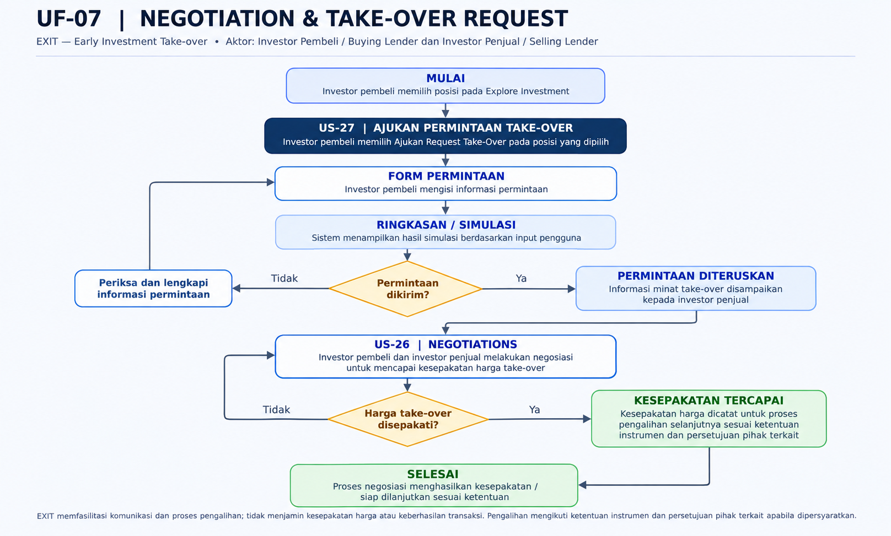

# UF-07: Negotiation & Take-Over Request

**Product:** EXIT — Early Investment Take-over  
**Feature:** Negotiation & Take-Over Request  
**Actor:** Investor Pembeli / Buying Lender dan Investor Penjual / Selling Lender  
**Related User Stories:** US-26, US-27  
**Access:** Registered User (setelah login)

## 1. Deskripsi

User Flow ini menjelaskan proses pengajuan permintaan take-over oleh investor pembeli terhadap posisi investasi yang dipilih serta proses negosiasi antara investor pembeli dan investor penjual untuk mencapai kesepakatan harga pengalihan.

Melalui fitur ini, investor pembeli dapat mengajukan permintaan take-over dari halaman Explore Investment. Sistem menampilkan ringkasan atau hasil simulasi berdasarkan informasi yang dimasukkan pengguna. Permintaan tersebut menjadi sarana penyampaian minat kepada investor penjual.

Selanjutnya, kedua pihak dapat melakukan negosiasi melalui halaman Negotiations untuk mencapai kesepakatan harga take-over. Proses pengalihan berikutnya tetap mengikuti ketentuan instrumen, perjanjian awal, serta persetujuan pihak terkait apabila dipersyaratkan.

## 2. Rincian User Stories

### US-26: Negosiasi Harga Take-Over

**User Story:**

Sebagai investor penjual dan pembeli, saya ingin melakukan negosiasi agar dapat mencapai kesepakatan harga take-over.

**Acceptance Criteria:**
- Fitur negosiasi tersedia bagi investor penjual dan pembeli.
- Kedua pihak dapat melakukan negosiasi harga take-over.
- Fitur mendukung proses pengajuan penawaran untuk mencapai kesepakatan.

### US-27: Pengajuan Permintaan Take-Over

**User Story:**

Sebagai investor pembeli, saya ingin mengajukan permintaan take-over terhadap posisi investasi yang dipilih agar dapat menyampaikan minat untuk mengambil alih posisi tersebut kepada lender lama.

**Acceptance Criteria:**
- Investor pembeli dapat mengajukan permintaan take-over terhadap posisi yang dipilih.
- Sistem dapat menampilkan hasil simulasi berdasarkan input pengguna.
- Permintaan take-over menjadi sarana penyampaian minat kepada investor penjual.

## 3. Alur Proses

1. Investor pembeli membuka menu Explore Investment.
2. Investor pembeli memilih posisi investasi yang ingin diambil alih.
3. Investor pembeli memilih tombol Ajukan Request Take-Over.
4. Sistem menampilkan formulir permintaan take-over.
5. Investor pembeli mengisi informasi permintaan yang diperlukan.
6. Sistem menampilkan ringkasan atau hasil simulasi berdasarkan input pengguna.
7. Investor pembeli memeriksa informasi permintaan sebelum mengirimkannya.
8. Permintaan diteruskan kepada investor penjual sebagai penyampaian minat take-over.
9. Kedua pihak membuka halaman Negotiations.
10. Investor pembeli dan investor penjual melakukan negosiasi untuk mencapai kesepakatan harga take-over.
11. Jika belum tercapai kesepakatan, proses negosiasi dapat dilanjutkan.
12. Jika tercapai kesepakatan, informasi kesepakatan dicatat untuk mendukung proses pengalihan berikutnya sesuai ketentuan yang berlaku.

## 4. Aturan dan Catatan

- Permintaan take-over merupakan penyampaian minat investor pembeli terhadap posisi investasi yang dipilih.
- Negosiasi dilakukan oleh investor pembeli dan investor penjual untuk mencapai kesepakatan harga take-over.
- Hasil simulasi ditampilkan berdasarkan input pengguna dan tidak otomatis menjadi harga transaksi final.
- Kesepakatan harga tidak dengan sendirinya berarti pengalihan telah selesai.
- Proses pengalihan harus mengikuti ketentuan instrumen, perjanjian awal, dan persetujuan pihak terkait apabila dipersyaratkan.
- EXIT berperan sebagai fasilitator proses pengalihan dan tidak menjamin kesepakatan harga maupun keberhasilan transaksi.

## 5. Diagram User Flow

