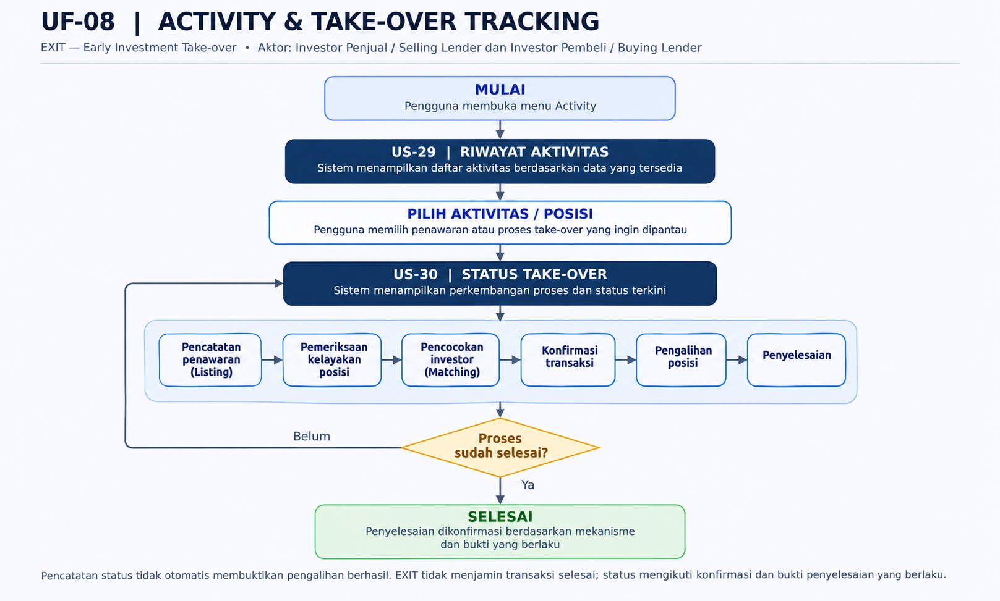

# UF-08: Activity & Take-Over Tracking

**Product:** EXIT — Early Investment Take-over  
**Feature:** Activity & Take-Over Tracking  
**Actor:** Investor Penjual / Selling Lender dan Investor Pembeli / Buying Lender  
**Related User Stories:** US-29, US-30  
**Access:** Registered User (setelah login)

## 1. Deskripsi

User Flow ini menjelaskan proses pencatatan riwayat aktivitas dan pemantauan perkembangan pengalihan posisi investasi melalui aplikasi EXIT.

Melalui fitur Activity, pengguna dapat melihat riwayat aktivitas yang pernah dilakukan di EXIT. Pengguna juga dapat memilih penawaran atau proses take-over tertentu untuk mengetahui perkembangan statusnya.

Fitur Take-Over Tracking dirancang untuk menghubungkan beberapa tahapan proses pengalihan, mulai dari pencatatan penawaran (listing), pemeriksaan kelayakan posisi, pencocokan investor (matching), konfirmasi transaksi, pengalihan posisi, hingga penyelesaian.

Dengan adanya pelacakan terintegrasi, pengguna dapat memperoleh informasi status yang konsisten serta mengetahui perkembangan proses dan tindakan yang masih diperlukan.

## 2. Rincian User Stories

### US-29: Riwayat Aktivitas

**User Story:**

Sebagai investor, saya ingin melihat riwayat aktivitas agar dapat mengetahui aktivitas yang pernah dilakukan di EXIT.

**Acceptance Criteria:**
- Sistem menampilkan riwayat aktivitas berdasarkan data yang tersedia.
- Pengguna dapat melihat aktivitas yang pernah dilakukan melalui menu Activity.

### US-30: Pemantauan Status Take-Over

**User Story:**

Sebagai investor, saya ingin memantau status proses take-over agar mengetahui perkembangan pengajuan dan penawaran.

**Acceptance Criteria:**
- Sistem menampilkan status proses take-over melalui aplikasi.
- Pengguna dapat mengetahui perkembangan pengajuan dan penawaran.
- Informasi status ditampilkan sesuai tahapan proses pengalihan yang tercatat.

## 3. Alur Proses

1. Pengguna login ke aplikasi EXIT.
2. Pengguna membuka menu Activity.
3. Sistem menampilkan daftar riwayat aktivitas berdasarkan data yang tersedia.
4. Pengguna memilih penawaran atau proses take-over yang ingin dipantau.
5. Sistem menampilkan detail aktivitas dan status proses take-over.
6. Sistem menampilkan perkembangan proses berdasarkan tahapan yang tercatat, meliputi:
   - Pencatatan penawaran (Listing).
   - Pemeriksaan kelayakan posisi.
   - Pencocokan investor (Matching).
   - Konfirmasi transaksi.
   - Pengalihan posisi.
   - Penyelesaian.
7. Pengguna dapat memantau perubahan status selama proses berlangsung.
8. Apabila proses belum selesai, pengguna dapat kembali melihat perkembangan status.
9. Apabila proses telah selesai, sistem menampilkan informasi penyelesaian berdasarkan konfirmasi dan bukti yang berlaku.

## 4. Aturan dan Catatan

- Riwayat aktivitas ditampilkan berdasarkan data aktivitas yang tersedia di aplikasi.
- Status take-over harus menggambarkan perkembangan proses sesuai tahapan yang tercatat.
- Informasi status perlu disajikan secara konsisten agar pengguna mengetahui perkembangan dan tindakan yang masih diperlukan.
- Tahapan pengalihan dapat bergantung pada karakteristik instrumen dan mekanisme yang berlaku.
- Status proses yang tercatat tidak secara otomatis membuktikan bahwa pengalihan telah berhasil.
- Penyelesaian transaksi harus dikonfirmasi berdasarkan mekanisme dan bukti penyelesaian yang berlaku.
- EXIT berperan sebagai fasilitator pencatatan dan pemantauan proses, bukan sebagai pihak yang menjamin keberhasilan pengalihan.

## 5. Diagram User Flow

